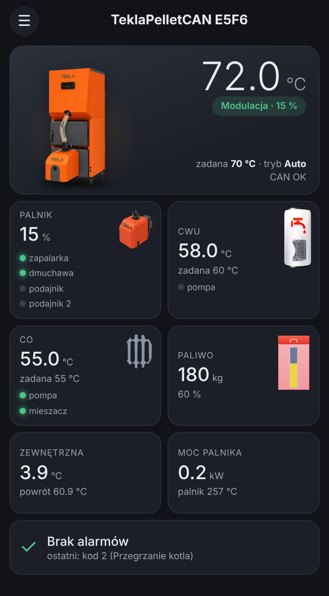
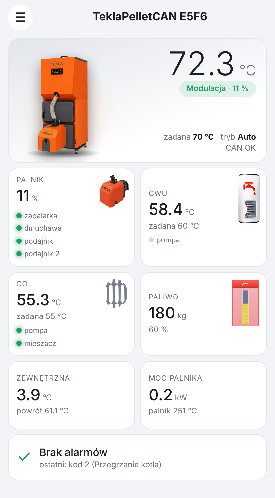
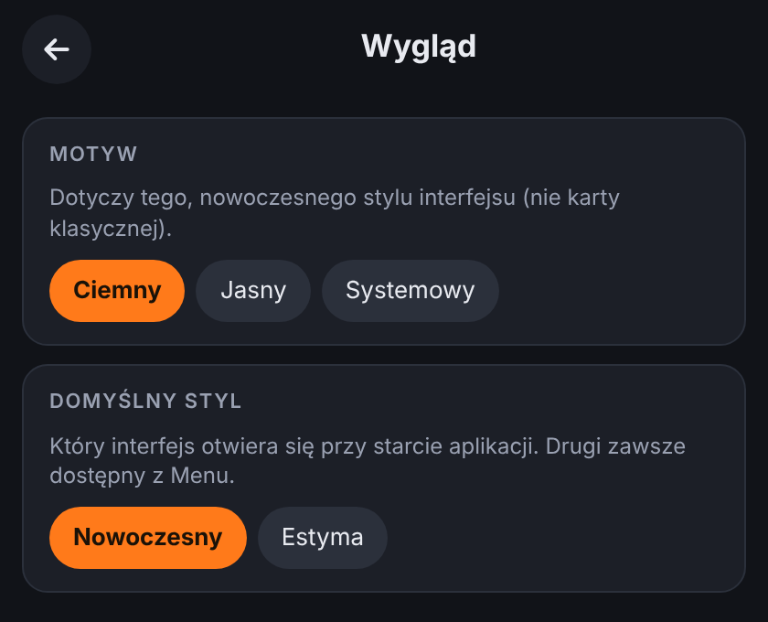

# TeklaPelletDroid

Aplikacja Android do sterowania kotłem pelletowym Tekla/Estyma przez moduł TeklaPelletCAN (urządzenie podłączane
do magistrali CAN kotła). Działa w tej samej sieci Wi‑Fi co moduł; znajduje go automatycznie albo po adresie IP.

<p>
  
  
  
</p>

## Co potrafi

- **Pulpit** (kocioł, palnik, CWU, CO, paliwo, alarmy, temperatury), **Instalacja** (schemat na żywo), **Nastawy**,
  **Alarmy** (historia, potwierdzanie), **Wszystkie parametry** z poziomami dostępu.
- **Poziomy kotła 1 i 2** (PIN jak w panelu kotła): klawiatura PIN, plakietka poziomu, autoblokada po 5 minutach
  bezczynności.
- **Tryb demo**: wirtualny kocioł z żywymi odczytami, bez sieci i bez modułu – do wypróbowania aplikacji.
- **Panel oryginalny** i **konfiguracja modułu** (aktualizacja oprogramowania, dziennik, Wi‑Fi) w osobnym oknie.
- Gdy moduł jest nieosiągalny: ostatnie znane wartości z godziną i baner „Brak połączenia z kotłem”.

## Instalacja

Pobierz `teklapelletcan.apk` z [wydań tego repozytorium](../../releases) i zainstaluj ręcznie (Android 10+; wymaga
zezwolenia na instalację z nieznanych źródeł).

## Konfiguracja aplikacji

Menu → **Ustawienia aplikacji**:

- **Zmiana PIN-u aplikacji** (ten z pierwszego uruchomienia — chroni tylko start aplikacji).
- **Odcisk palca zamiast PIN-u** — jeśli telefon ma skonfigurowaną biometrię.
- **Blokuj aplikację przy uruchomieniu** — wyłączenie zostawia aplikację w trybie "zawsze odblokowana" (dalej
  obowiązuje osobny PIN poziomu kotła przy zapisie, patrz niżej).

Menu → **Wygląd**:

- **Motyw** — ciemny / jasny / systemowy.
- **Domyślny styl interfejsu** — nowoczesny (ten opisany w "Co potrafi" wyżej) albo klasyczny (replika panelu
  Estyma Igneo Touch) — przełącznik dostępny również bezpośrednio z pulpitu.

Menu → **Zmień urządzenie** — dodanie kolejnego modułu TeklaPelletCAN (wyszukiwanie w sieci lub po adresie IP) i
przełączanie się między już dodanymi, bez usuwania poprzednich.

**Tryb developera** (ukryty, nieprzeznaczony dla zwykłego użytkownika): PIN `1948` wpisany na ekranie "Poziom
kotła" (Menu) przenosi do ekranu z wyborem kanału aktualizacji (stabilny/beta) — normalnie aplikacja sprawdza i
proponuje tylko stabilne wydania.

## Bezpieczeństwo

PIN aplikacji (opcjonalny) chroni tylko uruchomienie aplikacji. Osobny PIN poziomu kotła (0900/0999, jak w panelu
fizycznym) chroni zapis parametrów i wygasa po 5 minutach bezczynności.

## Komunikacja — jak to działa

```
Aplikacja (ekrany + obsługa) ── REST/WebSocket, w sieci lokalnej ──▶ moduł TeklaPelletCAN ──CAN── kocioł
```

Aplikacja łączy się z modułem **tylko w sieci lokalnej** — nie potrzebuje internetu do sterowania kotłem (internet
jest używany wyłącznie do sprawdzenia, czy jest nowsza wersja aplikacji/oprogramowania modułu; można to też zrobić
ręcznie, offline). Każdy zapis parametru przechodzi przez wewnętrzną blokadę zapisu i wymaga poziomu dostępu (PIN).

## Zastrzeżenia

Projekt niezależny i nieoficjalny, niezwiązany z firmami Tekla ani Estyma. **Nie jest zamiennikiem oryginalnego
sterownika kotła.** Zapis parametrów odbywa się na własne ryzyko i może naruszać warunki gwarancji producenta oraz
prowadzić do uszkodzenia lub nieprawidłowej pracy kotła/sterownika. Licencja: [LICENSE](LICENSE).
